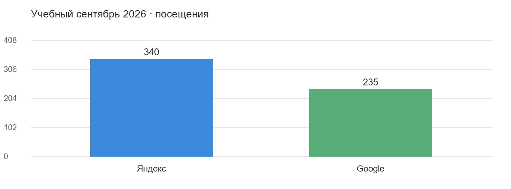
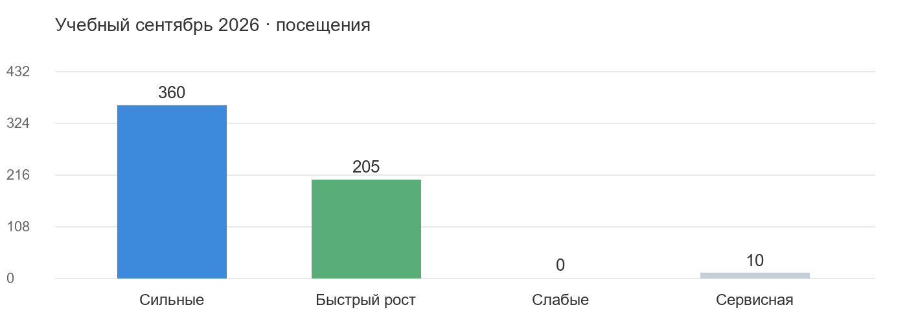

# Коммерческое предложение для мебельного проекта

Учебный SEO-проект для example.org

Учебное агентство · 6 октября 2026

Все сведения и числа вымышлены. Документ показывает формат предложения и не является тарифом, клиентским кейсом или обещанием результатов автора репозитория.

# Содержание и основной вывод

Покажем текущую поисковую точку, приоритетные страницы и семантические пробелы. Затем объясним предлагаемые изменения, сценарный расчёт, работу первого цикла, ресурс, ответственность и способ проверки результата.

Основной резерв учебного проекта — уже существующие страницы столов: категория получает поток и находится рядом с TOP, изготовление по размерам имеет спрос, но слабые позиции. Предлагаем начать с этих посадочных. Отдельный интент складного механизма проверим как кандидат новой страницы после подтверждения ассортимента.

Дальнейшие задачи выбираются из живой очереди внутри согласованного ресурса. Публикация клиентом и достоверное измерение влияют на результат. Прогноз ниже — условный расчёт, а не гарантия трафика.

В документе: позиции и входы; группы страниц; семантика; точки роста и ссылки; GEO и формула; сценарии; первый цикл; жизненный цикл страницы; смета и KPI; опыт и коммуникация; источники.

# Позиции и страницы входа

Период трафика — учебный сентябрь 2026. Позиции — 30 сентября 2026, Москва, одинаковые шесть запросов. Числа относятся к заданной выборке, а не всему реальному интернет-сайту.

| Показатель | Яндекс | Google |
|---|---|---|
| Органические посещения | 340 | 235 |
| Запросы мониторинга | 6 | 6 |
| Запросы в TOP 10 | 3 из 6 | 1 из 6 |
| Запросы в TOP 30 | 5 из 6 | 5 из 6 |

Общий органический поток — 575 посещений. Источники сопоставлены отдельно: позиции не заменяют трафик, а отсутствие технического отчёта не означает отсутствие ошибок.

Сопоставимой конкурентной выгрузки нет. Мы не делаем диагноз отставания по ссылкам или количеству страниц; для реального проекта это отдельная проверка с одинаковыми определениями метрик.

# Группы страниц и бизнес приоритеты

Поисковая группа показывает текущую силу страницы. Бизнес-приоритет отдельно задан клиентом: дубовые столы и изготовление по размерам. Нулевой поток сам по себе не является доказательством слабости.

| Группа | URL | Посещения | Решение |
|---|---|---|---|
| Сильные | 2 | 360 | Сохранить охват и улучшить отдачу |
| Быстрый рост | 2 | 205 | Доработать подтверждённые ограничения |
| Слабые | 1 | 0 | Проверить и переделать по доказанной задаче |
| Сервисная страница | 1 | 10 | Сохранить полезную функцию доставки |

/tables/oak/ — сильная приоритетная посадочная с 120 посещениями; /tables/ — приоритет быстрых улучшений с 160. /tables/custom/ требует доработки: в учебной постановке отдельно подтверждены спрос и индексирование, позиции 42/55 и недостаточно раскрыта услуга. /delivery/ не оценивается как товарная поисковая категория.

# Покрытие семантики

В ядре восемь уникальных запросов, шесть мониторятся: покрытие мониторингом 75%. Семь запросов сопоставлены с существующими URL: 87,5%. Эти доли измеряют разные свойства; отсутствие мониторинга не доказывает отсутствие позиции.

| Кластер | Пример запроса | Текущая посадочная | Решение |
|---|---|---|---|
| Изготовление по размерам | стол массив по размерам | /tables/custom/ | Расширить существующую |
| Складной механизм | складной деревянный стол | Не сопоставлена | Проверить кандидат нового интента |

Первый кластер нельзя превращать в дополнительный URL только потому, что запрос ещё не отслеживается. Для второго проверим ассортимент, спрос, удобство существующей категории и риск пересечения. Частотность запросов не переводим напрямую в посещения.

# Точки роста и ссылки для Google

## Улучшить существующие страницы

| Страница | Сигнал | Предлагаемая работа | Проверка |
|---|---|---|---|
| /tables/ | 160 посещений и позиции 12/18 | Выбор размеров и материалов, соответствие интенту и требования к блокам | Публикация и сопоставимые позиции/входы |
| /tables/custom/ | Спрос, индексирование и позиции 42/55 | Условия изготовления, процесс заказа и подтверждённые примеры | Приёмка и измерение выбранного кластера |
| /tables/oak/ | Сильная приоритетная посадочная | Сохранить релевантность, уточнить доказательства выбора | Не потерять текущий охват |

## Проверить создание новой страницы

Кандидат — самостоятельный интент складного механизма. Создание начинается после подтверждения линейки и проверки отсутствия подходящей посадочной. Результат этой проверки может быть расширением существующей страницы, а не новым URL.

## Ссылочный дожим

Целевой кандидат Google — /tables/: она соответствует поисковой задаче и уже видима. Но ссылочного аудита в учебных данных нет; слабость профиля не утверждается. Перед размещениями проверим релевантные страницы и площадки, необходимость фонда и правила оценки результата. Внешние расходы отделены от гонорара агентства.

# GEO и формула роста

В этом запуске GEO не включается. Если клиент выберет его отдельно, сначала измерим реальные ответы: упоминание бренда, рекомендацию и цитирование различаем. Неизмеренную исходную точку нельзя выдавать за установленный разрыв.

В SEO рост зависит от технической доступности, покрытия интентов, релевантности, ссылок и скорости публикации. Это карта рычагов, а не измеренная мультипликативная модель. Коэффициенты не назначаются по внешнему виду сайта.

Обращения = органические посещения × измеренная конверсия.

В учебном сентябре 23 подтверждённых обращения из 575 посещений дают 4%. Определение и дедупликация относятся к той же выборке. Конверсия применяется к обращениям; ею нельзя умножать трафик и называть итог посещениями.

# Сценарный прогноз

Для иллюстрации взята одна когорта: оптимизация /tables/ с базой 160 посещений в месяц и новая страница складного интента после подтверждения её необходимости. Прирост существующей — 20/30/40%; зрелый поток новой — 30/50/70. Это допущения трёх сценариев, а не проверенные нормы.

| Сценарий | Зрелый прирост в месяц | База и прирост в зрелый месяц | Накопленный прирост за 6 периодов |
|---|---|---|---|
| Осторожный | 62 | 637 | 232,5 |
| Рабочий | 98 | 673 | 367,5 |
| Ускоренный | 134 | 709 | 502,5 |

Единицы — дополнительные посещения или общий месячный поток. Базовая траектория 575 постоянна только как условное допущение. Созревание после публикации по периодам: 0; 25%; 50%; 100%; 100%; 100%. В рабочем сценарии прирост первого периода 0, второго 24,5, третьего 49, с четвёртого 98. Накопленный эффект — сумма периодов, а не зрелый поток, умноженный на шесть.

Задержка публикации сдвигает траекторию. Повторные изменения одного URL не создают ещё одну независимую когорту. Числа математического ожидания могут быть дробными; это не фактическое число будущих посетителей. Для реального прогноза нужна калибровка по сопоставимым страницам; гарантии здесь нет.

# Работы первого цикла и живая очередь

Первый цикл направлен на проверку и внедрение приоритетного решения. В пределах 18 согласованных часов уточним данные, проверим интенты, подготовим требования к /tables/ и /tables/custom/, согласуем их с клиентом и проверим опубликованные изменения. Технические ограничения проверяются отдельно по доступным отчётам.

| Работа | Передаваемый результат | Приёмка |
|---|---|---|
| Сопоставление спроса и URL | Карта выбранных интентов | Нет дублирующих посадочных |
| Требования к приоритетным страницам | Конкретные изменения блоков и текста | Клиент понимает, что внедрять |
| Поддержка публикации | Проверка реализованных изменений | Согласованные задачи приняты |
| Измерение | Срез по тем же страницам/запросам | Период, источник и ограничения видны |

Далее ведём живую очередь по эффекту, данным и готовности клиента внедрять. Не обещаем одинаковую квоту новых страниц каждый месяц. Отсутствие искусственной квоты не означает неограниченную работу: действует согласованный ресурс. Если требуется больше мощности, новый объём и стоимость обсуждаются отдельно.

# Жизненный цикл страницы

| Шаг | Результат | Ответственная сторона |
|---|---|---|
| Выбор | Подтверждённый интент и бизнес-смысл | Агентство и клиент |
| Диагностика | Основания конкретной доработки | Агентство |
| Требования | Блоки, содержание, SEO и приёмка | Агентство |
| Контент | Проверенные материалы и примеры | Клиент с поддержкой агентства |
| Согласование | Принятый объём | Клиент |
| Публикация | Работающая страница | Клиент и его разработчик |
| Контроль | Проверка внедрённого | Агентство |
| Измерение | Сопоставимый эффект после публикации | Агентство и клиент |

Переданное ТЗ не равно опубликованной странице. Окно оценки начинается после фактического внедрения и контрольной проверки, а не по дате создания документа.

# Смета условия и KPI

| Статья | Результат или ресурс | Сумма в месяц |
|---|---|---|
| SEO агентства | 18 часов по 2500 ₽ | 45 000 ₽ |
| Внешний фонд при выборе | Согласованные размещения отдельно | 10 000 ₽ |
| Итог с фондом | Две указанные статьи | 55 000 ₽ |
| Контент и разработка клиента | Внедрение согласованных задач | Не определено и не включено |

Все цены вымышлены для примера. Без выбора внешнего фонда первый цикл стоит 45 000 ₽ по этим учебным условиям. Дополнительные работы не входят в ресурс автоматически. Бонус и гарантии роста не согласованы.

KPI разделены: приёмка работ агентства; публикация клиентом; затем эффект на выбранных опубликованных страницах в сопоставимом окне. Baseline — учебный сентябрь 2026, позиции 30 сентября. Будущую контрольную дату назначаем после публикации; при задержке внедрения окно сдвигается. Весов 70/30 и условия бонуса по умолчанию нет.

# Опыт коммуникация и следующий шаг

Подтверждённых клиентских кейсов в примере нет. Их нельзя заменить вымышленными успехами. Для реального предложения агентство добавляет только разрешённый релевантный опыт с источниками.

В учебном сценарии клиент принимает объём и обеспечивает контент/разработку; агентство готовит требования, сопровождает внедрение и измеряет. Встреча по первому циклу — согласовать страницы, результат и ресурс; затем короткий регулярный отчёт по опубликованным задачам и незакрытым зависимостям. Периодичность отчётности в реальном проекте подтверждается условиями агентства.

Следующий шаг — подтвердить состав первого цикла и доступные технические отчёты. По мере проверки уточняется объём, выбранный внешний фонд и контрольные даты. Предложение связывает конкретные изменения с проверкой; оно не обещает рост без внедрения.

# Источники и ограничения

| Материал | Период и охват | Использование |
|---|---|---|
| pages.csv | Учебный сентябрь 2026, шесть URL | Поток, группы и решения |
| queries.csv | 30 сентября, восемь запросов ядра | Позиции, мониторинг и сопоставление |
| brief.md | Учебные указания клиента и агентства | Приоритеты, конверсия и экономика |
| forecast.csv | Шесть условных периодов | Сценарии по одной когорте |

Технический аудит, конкурентные ссылки и GEO реально не измерялись. Все входные данные синтетические. Word/PDF показывает готовую форму, но не означает независимую приёмку агентом или согласие клиента. Подробные расчёты и происхождение допущений находятся рядом с документом.
