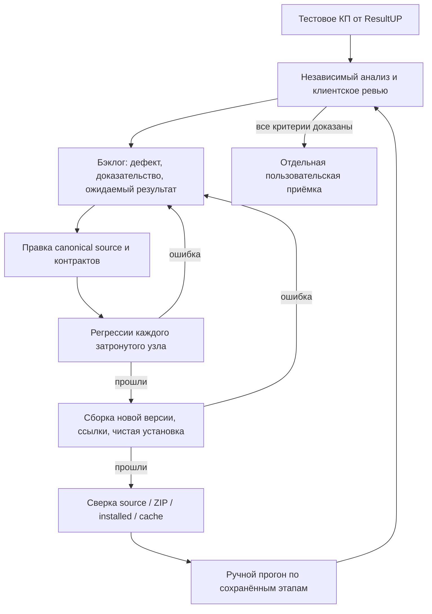

# Схема развития Оффериста

Адаптировано из проверенных TESTING_WORKFLOW, quality-loop и registry/dependencies репозитория [СУК](https://github.com/mekotenkov-ux/seomeat-killer-copywriters/tree/423ea3fa90135f9af0d26ceb87f9336ef1844bf2/seomeat-killer-copywriters/skills/content-author-layer/references/system). Перенесены контракты узлов, доказательства проверок, локальная инвалидация и неизменяемые версии. Предметные SEO-анализы определяются контрактами Оффериста, а не контентным процессом СУК.

Для каждой задачи бэклога: ID, наблюдаемое отклонение, источник/место, ожидаемый выход, fixture, причина, затронутые узлы, исправление, проверка закрытия и статус. Не закрывать поведенческий дефект только по изменённому коду. Замечание пользователя сохраняется с областью агентство/проект/запуск, без чужих фактов в универсальном правиле.

## Контрольные точки

1. Перед узлом — разрешённые входы, актуальные версии/хеши и принятые зависимости.
2. После узла — фактический артефакт, охват/пробелы, проверка входного/выходного контракта, квитанция попытки.
3. Перед текстом — независимый structure review текущей карты решения.
4. Перед финальным ревью — точный клиентский пакет без истории автора и его самооценки.
5. Перед установкой — проверки узлов, portable smoke, новая версия, хеши пакета.

Это места применения проверок/хуков; внешняя платформа может вызывать shipped CLI. Команды из клиентских документов или неизвестной конфигурации автоматически не исполняются.

Изменение источника, объёма или текста инвалидирует зависимые результаты и старое ревью. Соседние ветки с прежними входами переиспользуются. Проверенный raw snapshot не надо пересобирать ради статуса. [Workflow CLI](workflow.md) хранит историю попыток и показывает, какой узел можно выполнить следующим.

Source, установленный пакет и экспорт сверяются по одному manifest; ZIP старой версии не перезаписывается. Code/unit pass, ручной evidence pass, content verdict, коммерческие условия и пользовательская приёмка фиксируются отдельно. Partial/unknown не становятся полным выполнением заказа.
