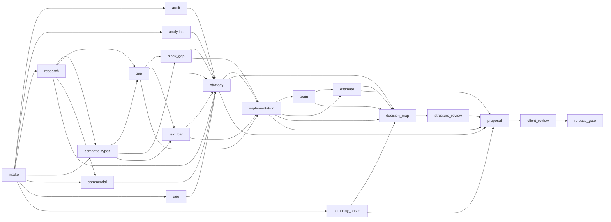

# Ручной replay одного КП

`scripts/workflow.py` хранит проверяемый журнал в папке конкретного прогона. Он не вызывает API, LLM или команды из конфигурации. Единственный локальный исполняемый анализ — фиксированный bundled BAR CLI для проверки сохранённого результата. Контракт узлов находится в `skills/offerist/references/workflow-contract.json`. Попытка привязана к хешам своего узла, общей политики и вычисляющего кода; правка `company_cases` не переоткрывает `audit` или `analytics`. Правки `site_gap.py`, BAR adapter/CLI/bundle/manifest переоткрывают соответствующие узлы и их потомков.

Схема **генерации одного КП** ниже дословно отражает 20 узлов и рёбра `depends_on` в JSON-контракте. Она описывает зависимости артефактов, а не отдельный цикл разработки плагина. Ветка `geo` активна при `geo=yes`; при `undecided` её решение остаётся открытым.

<!-- workflow-contract-mermaid-start -->

<!-- workflow-contract-mermaid-end -->

В основном контуре `offerist.py init-run` создаёт `scope.json` с `agency_id`, `run_id`, `site`, `geo`, `geo_user_quote` и при необходимости `exceptions`. Не перезаписывайте эти поля вручную: основной `check` связывает их с `run.json` и последним intake. Для отдельного тестового запуска одного `workflow.py` без `offerist.py` допустим минимальный `{"geo":"undecided","exceptions":[]}` (затем `geo: yes` или `no` по решению пользователя). Выполните:

```text
python scripts/workflow.py init --run <run-folder> --run-id <id> --scope scope.json
python scripts/workflow.py resume --run <run-folder>
python scripts/workflow.py next --run <run-folder>
python scripts/workflow.py scaffold --run <run-folder> --node intake --out manifests/intake.json
python scripts/workflow.py record --run <run-folder> --manifest manifests/intake.json
python scripts/workflow.py record --run <run-folder> --node intake --actor seller --status partial --reason "GEO decision pending" --blocker "user GEO choice" --input brief=brief.md --input agency_profile=profile.json --output scope=intake-scope.json --check sources --check goals --check geo_choice --check agency_terms
python scripts/workflow.py status --run <run-folder>
python scripts/workflow.py invalidate --run <run-folder> --node gap --reason "new URL inventory"
```

В `record` каждый `--input` и `--output` ссылается на файл внутри папки прогона. Имена и `--check` перечислены в контракте. Значение `--check` означает, что исполнитель выполнил ручную проверку; CLI самостоятельно пересчитывает хеши, зависимости, покрытие типов в структурированных реестрах и привязки рецензий. Смысловую истинность наблюдений и полноту исходной выгрузки подтверждает человек по самим источникам.

Контракт `.26` требует для каждого `partial` адресный `pending_items[]` в основном JSON-выходе узла: уникальный `pending_id`, `state: pending|unknown|unavailable`, `scope_kind`, `scope_id`, `type_id` либо `null`, `source_ref` run-relative либо `null`, конкретные `reason`/`blocker` и `counted_in` (например, `urls`, `blocks`, `tasks` или `stage`). `source_ref:null` допустим, когда файл ещё не получен; уже использованный файл укажи и сохрани. Известные строки, количества, scored BAR и N/A проверяются и при `partial`; unknown остаётся в знаменателе, не становится нулём или готовой работой. Результат `status.validation.<node>.known_scope_valid` означает прохождение доступных структурных/source проверок текущей `.26` попытки; `coverage`, `availability` и `completion` независимы. `content_scope_complete` требует полного закрытия активных узлов и не следует из `known_scope_valid`. Старые попытки не получают новую отметку автоматически.

Реально цитируемые вложенные `source_ref`/`evidence_refs` и первичные CSV, HTML, raw receipts сохраняются в `consumed_sources` только потребляющего узла с ролью и SHA-256. Сохранённый run-relative файл в поддерживаемом поле привязывается независимо от расширения, расположения в корне run или вложенного пути; отсутствующая ссылка, похожая на файл, отклоняется. Логические ID доказательств (`peer:1`, `task:source`) и URL не считаются локальными файлами. Правка источника инвалидирует его потребителей и потомков, но не независимую ветку. `--check` остаётся ручной декларацией и не равен `known_scope_valid:true`; при malformed `rows`, неполном ledger или несходящейся сохранённой строке `record` завершается ошибкой.

`next` показывает для каждого доступного или ожидающего этапа `actor`, необходимые именованные входы и выходы, ручные checks, состояния зависимостей и последние причины/blockers. Это план продолжения, а не выполнение этапа. `scaffold` один раз записывает новый run-relative JSON с пустыми `status`, путями файлов и `checks`; существующий файл он не перезаписывает. Исполнитель заполняет реальные файлы и декларацию вручную. Пример минимальной формы:

```json
{"schema_version":1,"node":"intake","status":"complete","actor":"seller","inputs":{"brief":"brief.md","agency_profile":"profile.json"},"outputs":{"scope":"intake-scope.json"},"checks":["sources","goals","geo_choice","agency_terms"],"reason":"","blockers":[]}
```

Конкретные имена берутся только из `next`/контракта. `record --manifest` принимает только поля этой схемы и проводит **те же** проверки, что прямые CLI-флаги; одновременно передать манифест и флаги нельзя. Само наличие заполненных `checks` не доказывает смысловую проверку. Манифест входит в хеши входов: неизменные манифест и источники дают `reused: true`; правка его, источника или реализации переоткрывает узел и зависимых потомков. Пустой scaffold не может создать `complete`. Никаких команд, API-вызовов и решений по согласию/сметам манифест не запускает.

`semantic_types` выводит существующие типы из **всех** `url_universe.pages` и необходимые типы из **всех** `demand_universe.clusters`, затем сверяет их с объявленными `type_ids`. URL-строка содержит `source_row_id`, `url`, `type_id`, `variant_id`; optional `canonical_url` задаёт канонический адрес. Повтор того же канонического адреса требует `duplicate_of` с ID первой строки и `dedup_reason`; конфликтующие тип/вариант запрещены. `unknown` тип/вариант/статус не даёт `complete`. Оба источника содержат `evidence_by_type`; спрос также содержит `intent_ids_by_type`. `semantic_map` сохраняет объединение типов, источники, `presence_by_type` (`existing`/`missing`), intent IDs и решения. Пустой сайт требует `pages: []`, `empty_verified: true` и `empty_evidence`. Это доказывает согласованность сохранённых строк, но не полноту внешнего crawl или спроса.

Минимальная форма ключевых реестров (каждый JSON-выход также содержит непустой `evidence_refs`):

```json
{
  "semantic_map": {"type_ids": ["service", "new_type"], "presence_by_type": {"service": "existing", "new_type": "missing"}, "evidence_by_type": {"service": ["crawl:1"], "new_type": ["demand:1"]}, "intent_ids_by_type": {"service": [], "new_type": ["intent-new"]}, "decisions": {"service": "improve", "new_type": "create"}},
  "gap_register": {
    "type_ids": ["service", "new_type"], "site_gap_report_ref": "gap/site-gap-report.json",
    "allocation_unknown": [], "url_total": 1, "url_classified": 1, "demand_total": 1, "demand_allocated": 1,
    "weak_urls_by_type": {"service": ["/service"], "new_type": []}, "missing_intent_ids": ["intent-new"],
    "page_allocations": [{"url": "/service", "type_id": "service", "action": "optimize", "evidence_refs": ["crawl:1"]}],
    "create_candidates": [{"cluster_id": "intent-new", "task_type_id": "new_type", "landing_job_id": "job-new", "action_id": "a-new", "disposition": "create", "missing_intent_ids": ["intent-new"]}],
    "landing_jobs": [{"landing_job_id": "job-new", "published_type_id": "new_type", "task_type_ids": ["new_type"], "cluster_ids": ["intent-new"], "missing_intent_ids": ["intent-new"], "disposition": "create", "action_id": "a-new", "evidence_refs": ["demand:1"]}],
    "actions": [{"action_id": "a-service", "type_id": "service", "target_type_ids": ["service"], "decision": "improve", "affected_urls": ["/service"], "unit": "page", "quantity": 1, "dedup_key": "service-page", "effect_key": "service-content", "acceptance_criteria": ["published"], "evidence_refs": ["crawl:1"]}, {"action_id": "a-new", "type_id": "new_type", "target_type_ids": ["new_type"], "decision": "create", "landing_job_ids": ["job-new"], "unit": "page", "quantity": 1, "dedup_key": "new-page", "effect_key": "new-page", "acceptance_criteria": ["published"], "evidence_refs": ["demand:1"]}]
  },
  "implementation_plan": {"volumes_by_unit": {"page": 2}}
}
```

Показана только связь ключевых полей; фактический `implementation_plan.actions` полностью копирует тип, цели, единицы, количества, dedup/effect и acceptance criteria из выбранных `strategy_map.actions`, добавляя phase, dependency и итоговую приёмку.

Исходные формы, от которых эти реестры считаются: `url_universe.pages:[{"source_row_id":"crawl-1","url":"/service","type_id":"service","variant_id":"main"}]`; `demand_universe.clusters:[{"id":"intent-new","type_id":"new_type","status":"create_candidate"}]`. Для повторного raw URL добавьте `canonical_url`, `duplicate_of:"crawl-1"` и `dedup_reason`. Фрагмент решения стратегии для нового job: `{"source_id":"gap:a-new","disposition":"selected","action_id":"a-new"}`; мотивированное решение не создавать получает `{"source_id":"gap_job:job-rejected","disposition":"rejected_with_reason","reason":"подтверждённое решение не оказывать услугу"}`. Реальный журнал включает **все** исходные находки и действия, а не только эти строки.

`block_register.variants_by_type` перечисляет каждый требуемый и проверенный вариант с `variant_id`, `required`, `observed`, `evidence_refs`, `url_refs` для существующего типа и `landing_job_ids` для утверждённых будущих страниц. `url_variant_assignments` содержит ровно одну строку на каждый канонический URL из исходного inventory: `{"url":"/service","type_id":"service","variant_id":"main","status":"covered","evidence_refs":["html:1"]}`. Тип и вариант должны совпадать с raw URL; собственное доказательство с `source_url` должно разрешаться в сохранённый файл этого URL. Все `variants_by_type[].url_refs` вместе равны inventory, включая weak URLs. Каждая пара тип/вариант имеет строки `rows` с block_id, статусом (`sufficient`, `weak`, `missing`, `not_applicable`), собственным/конкурентным доказательством, датой и затронутыми URL либо утверждёнными landing jobs. Для интегрированного задания job может иметь другой `published_type_id`, но его `task_type_ids` должны включать тип строки. `weak`/`missing` требуют `change`, `unit`, `acceptance`; `sufficient`/`not_applicable` требуют `assessment_reason` и не создают фиктивную работу. `unknown` не проходит `complete` и может быть записан как `partial` с blocker.

Для доказанного отказа `rejected` или покрытия существующей страницей `no_new_page` у отсутствующего типа без собственного URL нужен evidence-only вариант с `observed:false`, `noncreate_job_ids` и отдельная строка с тем же ID. У отвергнутой задачи строка имеет `status:not_applicable`, точную исходную причину/`source_evidence_refs`, peer proof и нулевые `change/unit/acceptance` и own URL; у покрытой — `status:sufficient`, фактические `covered_by_urls` и сохранённое own-доказательство каждого URL. Такой job виден в стратегии и клиентском пакете как причина без action и цены.

Локальный `block_register.evidence_index` разрешает каждый ID из `variants_by_type[].evidence_refs` и `rows[].own_evidence_refs`/`peer_evidence_refs`/`evidence_refs` в сохранённый файл: `{"html:own-1":{"path":"blocks/own-service.html","sha256":"...","role":"own","media_type":"text/html","source_url":"https://..."}}`. Допустимы HTML, JSON render и PNG/JPEG/WebP. `path` находится внутри папки прогона, файл непустой, SHA сверяется при записи и повторном `status`. `source_url` — метаданные, не замена сохранённого HTML/рендера. Это проверка существования и целостности; достаточность блока и репрезентативность страниц остаются предметной проверкой.

Для `text_bar` выход `bar_report` — JSON manifest с массивом `reports`, **только для реально посчитанных** строк: `input_ref`, `report_ref`, `input_sha256`, `report_sha256`. `text_register.report_ref` указывает на него, `files` содержит SHA всех run-relative исходных текстов, входных JSON, ответов адаптера и доказательств применимости. Строка `rows` содержит `type_id`, `url`, `mode`, `input_ref`, `adapter_report_ref`, `own_text_ref`, `peer_text_refs`, `own_score`, `requirements`; URL существующего scored-типа также должен совпадать с `input.url` либо `input.own_page.url` (если заданы оба — они равны). При `record complete` CLI повторно запускает фиксированный bundled BAR CLI на каждом scored input и сравнивает весь детерминированный результат с report. Исключаются лишь генерируемые время и UUID снимка; сохранённый report целиком остаётся SHA-привязанным. Для `peer_creation` собственные score/text/URL равны `null`, отчёт имеет `mode=peer_only`, `reference_role=peer`, `peer_benchmark`. Для `own_and_peer` `own_score` — объект `{key_tfidf_score, weighted_coverage, weighted_density}` из реального `mode=own_vs_peers`, а не придуманный общий балл. Слабые URL должны иметь строки; входные тексты сверяются с сохранёнными файлами. Вход `far_method` содержит `source: BAR`, `version` равную `bar_commit`, `sha256` равный SHA bundle.

Для воспроизводимого native BAR replay сохраняй точные версии Node.js и ICU, которыми создан отчёт, и сравнивай при тех же условиях; различие описательных метрик между поддерживаемыми runtime само по себе не доказывает вымышленный источник. Это примечание о provenance, не изменение алгоритма или минимальной версии Node.

В `.14` вход `material_task_scopes` — один **проверенный человеком инвентарь существенных задач**, а не матрица всех URL и запросов. Он содержит `source_files: {"run-relative/path": "sha256"}` и `scopes`. У каждой задачи уникальный `scope_id`, `type_id`, конкретная `task_statement`, ровно один существующий `target_url` или явно указанный `landing_job_id` (для мотивированно отвергнутой отсутствующей задачи N/A возможен без них), `queries` для BAR и `required_extent: whole_page|section|future_page|future_candidate|not_applicable`. `source_evidence` содержит `file_ref`, `locator`, буквальный `observed_text`; для URL хотя бы одна запись содержит `source_url`, совпадающий с целевым URL и найденный в сохранённом файле, для будущей страницы/кандидата — `source_landing_job_id`. Для `whole_page` требуется `full_text_ref` на сохранённый полный текст страницы. Например, две задачи «Россия → Европа» и «Европа → Россия» одного URL — два `scope_id` и две проверенные диспозиции, даже если физически это одна посадочная.

`text_register.scope_coverage` содержит ровно одну строку на каждый `scope_id`: `status: scored|not_applicable`, `row_index` в реальном BAR-регистре и для scored `analyzed_extent`. `queries` задачи должны входить в сохранённый adapter input. `whole_page` требует, чтобы `full_text_ref`, `row.own_text_ref` и фактический `input.own_page.text` совпали; секционный отчёт не закрывает целую страницу. `peer_suitability` даёт по каждому фактически сравненному peer `peer_text_ref`, его точный `peer_url` из input, буквальный `observed_text` из сохранённого peer-текста и содержательное `basis` применимости **к этой задаче**. Совпадения URL/типа без релевантного направления и доказательного peer-пассажа недостаточно. Один реальный whole-page BAR report может покрыть несколько совместных задач при полном наборе запросов и **отдельном доказательстве пригодности каждого peer к каждой задаче**. Его `own_score` остаётся одним общим агрегатом отчёта, не двумя intent-specific score и не двумя оплачиваемыми работами. Outbound-only корпус не закрывает inbound. N/A сохраняет исходную причину и отсутствие score. Все применимые типы и слабые URL присутствуют в реестре; дополнительную задачу на том же URL нельзя молча потерять. `bar_scope:<scope_id>` получает отдельную диспозицию в strategy ledger. Изменение вложенного source-файла инвалидирует `text_bar` и его потомков, сохраняя независимые audit/analytics. Машина проверяет происхождение и полноту **заявленного** реестра; открытие всех существенных задач и смысловая пригодность peer остаются ручной проверкой.

Для каждого scored `text_register.scope_coverage[]` до стратегии записывается короткий `reading` с `note`, точным `source_pointer`, `applicability`, свободным `text_disposition` и, если есть основание, `proposed_text_change`. Native pointer разрешается как RFC 6901 скалярный лист текущего SHA-связанного отчёта при доступной зоне `all` или `text`; saved-text pointer указывает на точный фрагмент собственной/peer строки. N/A и pending сохраняют причины/блокеры без фиктивного reading. Стратегия выбирает BAR text action только при согласовании предложенного изменения и источника; no-text-change не требует action. `decision_map.bar_readings[]` точно переносит reading и стратегическую диспозицию до structure review; финальная `bar_summary` повторяет ту же связь с отчётом или копией сохранённого текста. Код проверяет адресность источника, а смысл — независимый Клиент.

До ответа владельца о новой странице сохранённый `gap_register` со статусом `partial` может содержать `landing_job` с `disposition: business_question`, `cluster_ids`, `task_type_ids`, непустыми `reason`/`evidence_refs`, без `action_id` и `published_type_id`. В `site_gap_input` список утверждённых `landing_jobs` при открытом решении отсутствует; отчёт показывает `approved_new_pages: null`, а не утверждённый ноль. Для такого типа `material_task_scopes` использует `required_extent: future_candidate`, `candidate_cluster_ids` и `source_evidence` одновременно к сохранённому GAP job (`source_landing_job_id`) и к исходному `demand_universe` (`source_cluster_id` каждого create_candidate). Строка BAR имеет `mode: peer_creation`, `page_disposition: candidate_pending`, `pending_landing_job_ids`, `url/own_text_ref/own_score: null`; фактический adapter report — `peer_only` с `own_score:null`. `scope_coverage.analyzed_extent: future_candidate`. Проверенный текстовый анализ может быть complete, но GAP, стратегия/внедрение и release не получают полного статуса до бизнес-решения. После решения источники меняются и зависимые узлы перепроверяются; pending candidate не становится утверждённой страницей, единицей сметы или продаваемым действием.

Для отсутствующего task type с `no_new_page` и доказанным существующим URL BAR сохраняет `mode:own_and_peer`, `page_disposition:covered_by_existing_url`, `actual_type_id` из raw inventory, `noncreate_job_ids` и реальный URL. На каждый покрывающий URL нужен сохранённый собственный текст и настоящий adapter report; task/comparison type может отличаться от физического типа URL. Отсутствие peer или текста остаётся partial, не N/A.

Обоснованный `mode: not_applicable` остаётся **строкой покрытия типа и URL**, но не получает выдуманного adapter report или числовых метрик. Пример для сохранённой страницы условий: `{"type_id":"legal","url":"/privacy","mode":"not_applicable","own_score":null,"input_ref":null,"adapter_report_ref":null,"own_text_ref":null,"peer_text_refs":null,"requirements":null,"applicability":{"functional_role":"legal","purpose":"other","intent":"прочитать условия","reason_code":"non_search_utility","reason":"обязательное юридическое уведомление, не поисковая посадочная","basis":"проверенные HTML и назначение в inventory","evidence_files":["sources/privacy.html"]}}`. Каждый `evidence_files` — непустой run-relative файл из `text_register.files` с SHA. Для существующего URL функция должна быть `navigation`, `legal` либо `service_utility`, а `purpose` совпадать с сохранённым site GAP inventory и не быть commercial/informational/mixed/unknown. Для отсутствующего типа N/A возможен только после `semantic_map.decisions[type]=reject`, с `functional_role: rejected_unrelated_type`, `reason_code: rejected_unrelated_demand`, `purpose: absent`, без URL. Отсутствие peers, корпуса, ранжирования, времени или проверки интента — `blocked`/`partial` с blocker, а не N/A. Каждый N/A BAR source получает в `strategy_map.decision_ledger` `disposition: not_applicable` с **той же** причиной и без action ID; последующие реестры сохраняют это решение. Полнота URL/типов не снимается. Смысловая пригодность классификации и сопоставимость корпуса остаются предметной проверкой.

Именованный вход `site_gap_input` — сохранённый JSON для штатного `site_gap.py`. CLI заново вызывает его детерминированную `summarize()` и сравнивает с именованным выходом `site_gap_report`; произвольный отчёт с ручным `true` не пройдёт. В исходном `demand_universe.clusters` каждый `create_candidate` сохраняет `id`, `type_id`, `status`; наборы ID/тип/статус должны совпадать с `site_gap_input.demand_review.clusters`. Если кластер получил мотивированное `disposition`, один и тот же объект решения с `basis` и `evidence` должен быть сохранён в обоих входах. Для полного GAP нужны `assessment.whole_site_gap_complete`, `type_gap_totals.type_allocation_complete`, `page_plan.decision_status: resolved` и пустой `gap_register.allocation_unknown`.

`site_gap_report.missing_intents.supported_count`, `type_gap[].supported_missing_intent_count` и `type_gap_totals.supported_missing_intent_count` считают **интенты**, не страницы. `page_plan.approved_new_pages`, `approved_new_page_job_ids`, `approved_new_pages_by_published_type` считают только утверждённые уникальные jobs после полного source-bound решения; при открытом решении они `null`, `decision_status: pending`. Клиентская таблица и смета берут число новых страниц из `page_plan` и идентичных `gap_register.landing_jobs`/create actions, не из числа интентов. Один job может покрыть несколько кластеров и типов задач: `task_type_ids` сохраняет типы спроса, `published_type_id` — тип единственной будущей страницы, а `create_candidates[].disposition: integrated_in_job` содержит `covered_by_landing_job_id` в исходном спросе, основание и evidence для отсутствия отдельной страницы.

Контракт `.27`: `site_gap_input.planned_url_dispositions[]` хранит ровно одно плановое решение на каждый наблюдаемый canonical URL для числовой проекции: `source_url`, `disposition: retain_canonical|retire_410|redirect_or_merge|pending`; разрешённое решение имеет непустые `basis` и run-relative `source_ref`, который SHA-привязан к GAP. `pending` требует причину; отсутствующая строка legacy-входа тоже считается ожидающим решением, не неявным retain. `redirect_or_merge` указывает ровно одно: `destination_url` на другой наблюдаемый явно `retain_canonical` URL или на уникальный `proposed_url` утверждённого create job; либо `destination_landing_job_id` на такой job, если новый адрес ещё pending. Цепочки, циклы, self-target, неразрешённые и чужие назначения отклоняются; pending адрес job оставляет проекцию `null`. Несколько источников могут сливаться в один удержанный destination или один новый job, который считается один раз. Каждый `landing_jobs[]` с `disposition:create` для числовой проекции имеет отдельный `proposed_url` на клиентском домене; совпадения с существующим или другим создаваемым canonical отвергаются. `page_plan.gross_observed_plus_approved_jobs` — валовое число известных существующих URL и утверждённых задач, **не** число будущих опубликованных URL. `page_plan.approved_published_page_target_all` и `type_gap[].approved_published_page_target` — только плановая canonical-проекция: при полном инвентаре, всех разрешённых маршрутах и новых идентичностях; иначе `null`, `projection_status: pending` и точные `pending_source_urls`/`pending_create_job_ids`. Известные page-work и approved create quantity остаются. В полном GAP проекция должна быть разрешена; partial хранит доступную работу. Фактический published/canonical count подтверждается только отдельной проверкой после внедрения, этот план его не доказывает.

Контракт `.28` уточняет человеческие решения без новой схемы или узлов. `demand_review.status:covered` означает подтверждённую применимость существенных условий пользовательской задачи; подходящий URL либо путь уточнения не снимает неизвестный бизнес-квалификатор. При выбранной будущей проверке её выполненный протокол и успешная функциональная проверка зависимой работы — разные результаты: ошибка или недоступная среда оставляет функциональное утверждение неподтверждённым до решения, нужного исправления и повторного успешного теста либо ограничивает выпуск без этого утверждения. Возможное исправление не входит автоматически в диагностическую работу. Это не меняет статус старых `.27` попыток и не доказывает live-состояние.

Каждый canonical URL имеет одну `page_allocations` запись с `keep|optimize|rework`. `actions` — отдельные единицы внедрения с `dedup_key`, `effect_key`, `target_type_ids`, `acceptance_criteria`, источниками и количеством. Один общий FAQ-ответ на главной и FAQ — один `shared_answer_record`, а price-template и отдельное исправление H2 на URL Кипра могут сосуществовать, если эффекты различны. Повтор одного эффекта на одном URL или повторная продажа одной существующей страницы как `unit:page` запрещены. Мотивированное `no_new_page` указывает подтверждённые существующие URL; `rejected` сохраняет исходную бизнес-причину. Незакрытый кандидат, интент или вопрос оставляет GAP partial. Типовое `improve` требует хотя бы один URL с `optimize`/`rework`; остальные URL типа могут быть `keep`.

`strategy_map.decision_ledger` содержит ровно одну диспозицию для каждого существенного источника: `gap:<action_id>`, `gap_job:<landing_job_id>` для мотивированных неcreate решений, `audit:<finding_id>`, `block:<type_id>:<variant_id>:<block_id>` для weak/missing, `bar:<type_id>:<url|creation>`, `commercial:<observation_id>`, а при `geo=yes` — `geo:<finding_id>` для материальных GEO-находок. Строка имеет `source_id`, `disposition: selected` и `action_id` либо `deferred_with_reason`/`rejected_with_reason`/`blocked` с непустой причиной; `gap_job` получает `rejected_with_reason` с исходной причиной без action. У выбранной аудитной/блочной находки `target_urls`/`target_landing_job_ids` точно равны источнику и входят в выбранный action; `source_change`, `acceptance`, `evidence_refs` сохраняют изменение, приёмку и доказательства. Выбранный weak block на `keep` URL не проходит без пересмотра page allocation. Cross-type shared action допустим при явном `cross_type_basis` и доказательстве и только для своих реальных целей. Проверка связности не доказывает смысловую достаточность действия — её рецензирует человек. Пропуск источника блокирует `complete`; аналитическое решение отложить или отклонить остаётся видимым. `strategy_map.actions` копирует проверенный scope/единицы/приёмку GAP для выбранных действий; `selected_action_ids` совпадает с каталогом и выбранными ID журнала. `decision_map.source_dispositions` и `client_packet.source_dispositions` переносят каждую диспозицию вместе с action ID или причиной; их `nonselected_source_ids` точно перечисляют невыбранные IDs. `implementation_plan.actions` покрывает выбранные действия без дублей и согласует объёмы. `team_needs` оставляет provider_by_role пустыми для человека. `estimate_sheet.volumes_by_unit` равен плану внедрения; штатное `commercial_status: estimate_pending_human` оставляет rates/sums/terms пустыми.

В `geo_findings.surfaces` каждый из трёх ответов (`yandex`, `google`, `chatgpt`) получает стабильный `surface_id`, запрос, дату, `answer_ref` и `assessment: material_findings | no_material_finding`. Для `no_material_finding` нужна причина; сырое AI-упоминание само по себе не превращается в задачу. `geo_findings.findings` — отдельный массив выводов: `{"finding_id":"geo-1","surface_id":"yandex-answer-1","materiality":"material","conclusion":"...","evidence_refs":["yandex:answer"],"action":"...","acceptance":"..."}`. У несущественного вывода нужны `materiality: not_material`, заключение, evidence и причина. `material_findings` на поверхности требует хотя бы один материальный вывод; каждый такой `finding_id` попадает в обязательный strategy ledger. Пустой `findings: []` допустим, только если все три поверхности имеют мотивированное `no_material_finding`.

Для `proposal=complete` именованный `proposal_document` — строго корневой `proposal.md`. После команды `offerist.py packet` выход `client_packet` — JSON-регистр с `proposal_sha256`, `packet_sha256`, `packet_receipt_ref:"packet-receipt.json"`, `packet_manifest_ref:"client-packet/<revision>/manifest.json"`, `section_order`, `source_dispositions` и `nonselected_source_ids`. CLI сравнивает хеш `proposal.md` с manifest и скопированным proposal внутри ревизии, хеш manifest — с главным receipt, каждый файл из manifest — с его SHA. Эти файлы входят в сигнатуру попытки: поздняя правка вложения инвалидирует `proposal` и клиентское ревью.

Контракт `.17` требует два файла в полном клиентском пакете: `visible-appendix.md` и `client-handoff.json`. Они лежат внутри той же ревизии и manifest, а основной `proposal.md` ссылается на приложение. В клиентской карте есть строка каждого типа и варианта из `block_register`: свои/peer URL, позиционный срез и охват, решения по URL, задача и **все** исходные intent IDs; само наличие intent не означает missing. Вторая карта охватывает каждую поблочную оценку; для выбранных находок показывает уникальный `action_id`, единицу и количество работы/сметы, этап и приёмку. `sufficient` и `not_applicable` различаются; `unknown` блокирует полный block GAP и не становится «работы нет». Имена внутренних JSON без вложенного читабельного приложения не закрывают полный handoff. Проверка сверяет строки с сохранёнными outputs и хешами файлов, а не утверждает, что текст убедителен клиенту.

`decision_map.measurement_plan` и клиентское приложение задают обоснованную первичную метрику: уникальное подтверждённое обращение, заказ, выручку или коммерческие поисковые клики. Для неё указывают событие, подходящий источник и доступность, период, дедупликацию, базу (измеренное число с источником либо `unknown` с причиной), статус proxy и проверку на Б3/Б6/Б12. Клик цели может быть наблюдённым proxy `event_count`, но не уникальным обращением. Если нет ни регистра, ни аналитики, `proxy` явно `planned`/`unavailable` с null источником и значением; ноль не подставляется. CRM необязательна. `company_case_pack` различает подтверждённый релевантный кейс и иллюстрацию; при отсутствии первого в клиентском приложении остаётся видимое поле для человека. Схема полей — в [runtime](../skills/offerist/references/runtime.md).

В `.21` новый план добавляет `promised_segments` для обещанной детализации результата: у planned-сегмента описан путь поля до подтверждённой записи, unknown bucket, тест и зависимости; unavailable-сегмент не является обязательным результатом. Структурная проверка валидирует только объявленные строки. Свежий Клиент сверяет, все ли разбивки из Б3/Б6/Б12 объявлены, и не принимает отсутствие строки как доказательство отсутствия обещания.

Коррекция `.18`: заявленное доступное измерение имеет сохранённый JSON receipt и отдельный непустой run-relative источник с SHA. Receipt сверяется с unit, event, периодом базы, dedup, числом и source kind; оба файла входят в inputs/fingerprint `decision_map`, поэтому их изменение инвалидирует карту, structure review и пакет, но не независимые audit/analytics. `planned`/`unavailable` с null остаются законными без файлов. Смета содержит адресуемые `lines[]` с `estimate_ref`, actions, единицей, количеством и этапами; каждый выбранный action встречается ровно один раз, а ссылка из `decision_map` разрешается в свою строку. Заполняемые человеком ставки, суммы и условия не становятся барьером содержательной готовности. Поля и границы проверки — в [runtime](../skills/offerist/references/runtime.md).

Коррекция `.19` уточняет тип значения плана и receipt: обращения, заказы, коммерческие поисковые клики и счётный proxy (`event_count`/`visit_count`/`click_count`) — целые неотрицательные числа; выручка и явно обозначенный непрерывный proxy могут быть дробными. `NaN`/`Infinity` отклоняются; отсутствие данных остаётся `null` с причиной, а не `0`. Эти проверки не превращают произвольный сохранённый файл в доказательство правильного внешнего подсчёта.

Коррекция `.20` дополняет только выход `proposal`: `client-handoff.json` имеет `schema_version:2`, `material_claims[]`, `visuals[]`, `bar_summary[]`. Существенные числа точки А продавец перечисляет в `material_claims` с точной видимой цитатой, единицей, периодом, охватом и ограничением. `observed`/`estimated` ссылается на короткую клиентскую таблицу `client-evidence/*.json` в **той же** ревизии пакета: `row_ids` и простое `calculation: identity|sum|count|mean` сверяются с сохранёнными строками (`row_id`, `value`, `unit`, `period`, `scope`, `source_system`, `origin_ref`, `limitation`). Для доли `calculation:{"op":"ratio","numerator_row_ids":["organic"],"denominator_row_ids":["all"],"scale":100}` проверяет непересекающиеся строки, общий исходный unit, ненулевой знаменатель и `unit:"percent"`; `scale:1` означает `unit:"ratio"`. `estimated` дополнительно сообщает `basis`. `unknown` содержит `value:null` и причину, без фиктивной таблицы или нуля. Это карта заявленных существенных чисел, а не регулярное выражение для каждого числа текста; полноту карты и пригодность исходного источника отдельно оценивает новый клиентский рецензент.

Минимальный фрагмент при отсутствии исходной базы: `{"material_claims":[{"claim_id":"traffic-base","status":"unknown","visible_quote":"База поисковых визитов не подтверждена","value":null,"unit":"visits","period":"текущий срез","scope":"сайт","reason":"Нет доступной аналитики"}],"visuals":[{"visual_id":"traffic","status":"not_applicable","data_fitness":"unavailable","reason":"Нет проверенных рядов для графика"}]}`. Цитата и причина видны в основном КП, строка claim — в короткой таблице приложения. При наблюдённом числе укажи `source_table_ref`, конкретные `row_ids`, `source_system`, `limitation`, `calculation`, `chart_fitness:suitable|unsuitable`; `unsuitable` требует причину. Для подходящих чисел `visuals.status:embedded`: файл PNG/SVG/JPEG/WebP в manifest, `source_claim_ids`, короткая подпись с единицей, периодом, источником и ограничением. Медиа и подпись должны присутствовать в каждом отправляемом формате `proposal.md`/`proposal.html`; ссылка на невстроенное изображение не считается. `not_applicable` допустимо при недоступных или непригодных рядах с видимой причиной; подходящее наблюдённое число нельзя спрятать за N/A. Код проверяет объявленные файлы и арифметику, человек — необходимость графика и корректность источника.

`bar_summary[]` имеет ровно одну строку для каждого `text_register.scope_coverage`: `scope_id`, `type_id`, `url`, `status`, конкретный текстовый вывод/действие и ограничение либо reasoned `not_applicable` с сохранённым доказательством. Для scored строки `report_ref` — точная копия текущего native adapter report внутри `client-evidence/`, SHA совпадает с `text_register`; числовой БАР-показатель показывать необязательно. Если он показан, `display_metric:{path,value}` должен разрешаться в native report, рядом видны метод, сравниваемые peer, шкала и уверенность. Это не единый SEO-балл и не прогноз лидов. Строки БАР, таблица чисел и решение о графике — короткие читабельные секции `visible-appendix.md`; машинные IDs и JSON-выгрузки остаются в `client-handoff.json`/приложенных файлах, не заменяя человеческого вывода. `offerist.py packet` копирует только явно перечисленные `client-evidence/` файлы; manifest/SHA и review lineage инвалидируются после их изменения. Старые частичные пакеты не становятся полными автоматически.

Контракт `.22` для нового полного client handoff требует `schema_version:3` и три узких дополнения: `demand_decisions[]` закрывает доступные raw query IDs через кластер, URL/job, peer, сохранённую позицию либо unknown и причину; `material_proofs[]` показывает безопасные точные копии/фрагменты выбранных block/audit источников или явно сужает недоступный вывод; `unique_works[]` равен всему selected implementation, включая внепоблочное измерение. Рендеренные строки находятся в `visible-appendix.md`, а показанные proof refs входят в exact manifest. Числовые source tables и native BAR остаются отдельными проверками; gate не утверждает смысловую достаточность клиентского объяснения.

Для клиентских строк допускаются `type_label`, `variant_label`, `block_label`, `work_label` — короткие человеческие названия; технические `type_id`, `action_id`, `estimate_ref` остаются точными ключами в handoff. Видимая таблица показывает URL, решение, 1 × страницу/другую единицу, этап и приёмку, а не печать Python/JSON-словаря и внутренних полей. Основной текст оставляет только вывод, проверяемые числа и план, подробную сверку — в приложении.

`structure_review` и `client_review` требуют `review_receipt` (`reviewer_id`, `producer_id`, `context_id`, `producer_context_id`, `candidate_sha256`, `verdict`, `independence_status: host_evidenced`) и отдельный `host_receipt` (`source: host_run_receipt`, `source_reference`, тот же candidate SHA, оба reviewer/producer ID и context ID). Первый receipt связывается с хешем `decision_map` и verdict `ready_to_draft`. Для второго вход `review_receipt` — строго корневой `review.json`; `candidate_sha256` и `packet_sha256` равны точному SHA manifest, `proposal_sha256` — SHA корневого и отправленного `proposal.md`, `content_verdict: accept` отделён от покупательского `verdict`. Основной `offerist.py check` сверяет те же файлы и reviewer/producer lineage с попытками workflow, возвращая `lineage_consistent`. При `estimate_pending_human` покупательский `verdict: accept` запрещён: содержательная приёмка КП не означает согласие с ещё не заполненной ценой. Run-local host receipt **не доказывает** фактический чистый запуск: проверяющий должен открыть внешний host log/source reference. `status.review_independence_verified=false`, `release_readiness=false` и `release_blockers` сохраняют это явным ручным блокером. При изменении карты или пакета старое ревью становится недействительным.

Статусы: `complete` требует всех файлов/проверок и пустых blockers; `partial` требует черновых файлов, причины и `--blocker`; `blocked` требует причины и blocker. `skipped` можно записать лишь с `{"node":"...","allow_skip":true,"user_quote":"...","source_ref":"..."}` в scope; цитата должна встречаться в указанном run-relative источнике. Локальный файл может быть составлен самим исполнителем, поэтому такой skip помечается `unverified_user_origin` и **не закрывает** полный исходный scope или release gate. Для принятого исключения требуется отдельно проверенный источник пользовательского решения за пределами этого CLI. При `geo=undecided` GEO имеет `decision_pending`, intake может быть `partial` с причиной, а независимые SEO-узлы продолжаются. `content_scope_complete=false` до решения. При `geo=no` GEO вне выбранного scope автоматически. Смена GEO-решения инвалидирует intake и GEO-потребителей, сохраняя неизменные raw SEO ветки по специальной сигнатуре intake без GEO. Частичные результаты могут питать черновые downstream узлы, но `release_gate=complete` и `content_scope_complete=true` с ними невозможны.

`release_receipt` хранит `content_scope_complete: true`, текущий `commercial_status` и `user_acceptance: "unknown"`. Если решение пользователя предположительно получено, вместо `unknown` можно записать объект `{"status":"accepted","source_ref":"user-note.md","user_quote":"..."}` либо `rejected`; цитата сверяется с файлом и входит в хеш-привязку. Run-local файл не подтверждает пользовательское происхождение, поэтому `status.user_acceptance` остаётся `unknown`, а заявление показывается отдельно как `user_acceptance_claim` до внешней проверки. `release_gate=complete` означает структурно проверенный пакет и полный content scope, даже когда ставки ещё заполняет человек и пользовательская приёмка остаётся неизвестной. `status` отдельно выдаёт `content_scope_complete`, `commercial_status`, `user_acceptance` и `review_independence_verified: false`.

`status` каждый раз сверяет файлы и эффективные сигнатуры родителей; исправление входа/выхода инвалидирует узел и всех зависимых потребителей. Неизменные соседние ветки сохраняются. `invalidate` вручную помечает узел и downstream closure, сохраняя историю попыток. `resume` показывает только доступные сейчас узлы и не выполняет этапы сам. После исправления источника выполните новый `record` для корня и затем для зависимых узлов. Прежние попытки остаются в `workflow-state.json`.

Структурный `content_scope_complete` не равен пользовательской приёмке: даже положительное ревью не доказывает достоверность источников, достаточность кейсов или реальную независимость рецензента. Эти проверки остаются частью ручной приёмки продавца и клиента.

## Точный адрес технического аудита

`audit_sources.resources` хранит `resource_id`, нормализованный `logical_key` для join, `source_kind` и сохранённый источник адреса с SHA-256. `html_canonical` использует `fetched_url`, `saved_html_ref`, `saved_html_sha256`; точный `href` одного `rel=canonical` становится целью запроса. `http_final` использует `fetched_url`, `http_receipt_ref`, `http_receipt_sha256` и JSON с точными `request_url`/`final_url`. `query_variant`/`fragment_variant` используют JSON `variant_receipt_ref` с `observed_url` и отдельный `diagnosis_scope`. Если адрес установить нельзя, `source_kind:unresolved` содержит причину и не подставляет URL по ключу. Иной host требует отдельного решения; CLI не перенаправляет туда адресную проверку.

`audit_sources.source_artifacts` сохраняет независимые отчёты Вебмастера, краулера или другой доступной методики: `source_id`, `source_system`, `artifact_ref`, `sha256`, `captured_at`, `scope`. В `audit_findings.source_access` явно указано `available|partial|unavailable` для GSC и использованных источников. Если GSC недоступен, `unverified_checks` сохраняет `source_system:gsc`, `check:index_status` и причину: недоступность не означает ноль ошибок. При наличии хотя бы одного сохранённого источника аудит может быть `complete` в **заявленном охвате** без GSC URL Inspection; полноту и достаточность этого охвата подтверждает аудитор. Находка с `evidence_kind:other` указывает `source_system` и ровно сохранённый `source_ref` соответствующего источника.

Для **выполненных** адресных проверок `inspection_receipts` содержит по одному `resource_id`, `source_system`, точному `request_url`, `response_ref`, `response_sha256`, `captured_at`; `audit_findings.url_diagnostics` содержит те же resource/source/URL/scope/response и статус. GSC `inspection_verdict` читается только из сохранённого `inspectionResult.indexStatusResult.verdict`. Для другого источника receipt задаёт `result_path` и `response_url_path` внутри его сохранённого JSON; `observed_status` и URL обязаны буквально совпасть с ответом и запросом. Google verdict нельзя приписать Вебмастеру или краулеру. URL-находка связывает `diagnostic_resource_id`, `source_system`, `diagnosed_request_url`, scope, response и фактический статус. Ключ `/service` и canonical `https://example.test/service/` требуют запрос именно со слешем; `Unknown` на `/service` не переносится на `/service/`. Все вложенные сохранённые HTML, HTTP/variant receipts, source artifacts и ответы входят в хеши входов audit: изменение файла инвалидирует audit и его зависимых потребителей, сохраняя analytics/research. Структурная сверка не доказывает внешний API-вызов или смысловую полноту аудита.

BAR для существующего URL принимает фактический адрес из `input.url` либо `input.own_page.url`. Если оба заданы, они обязаны совпасть; адрес должен точно совпасть со строкой `text_register`. Это не меняет replay адаптера и не связывает score с другим `page_type`. Неполные типы и слабые URL остаются partial/blocked, а несовпадающий тип отчёта не получает score.
